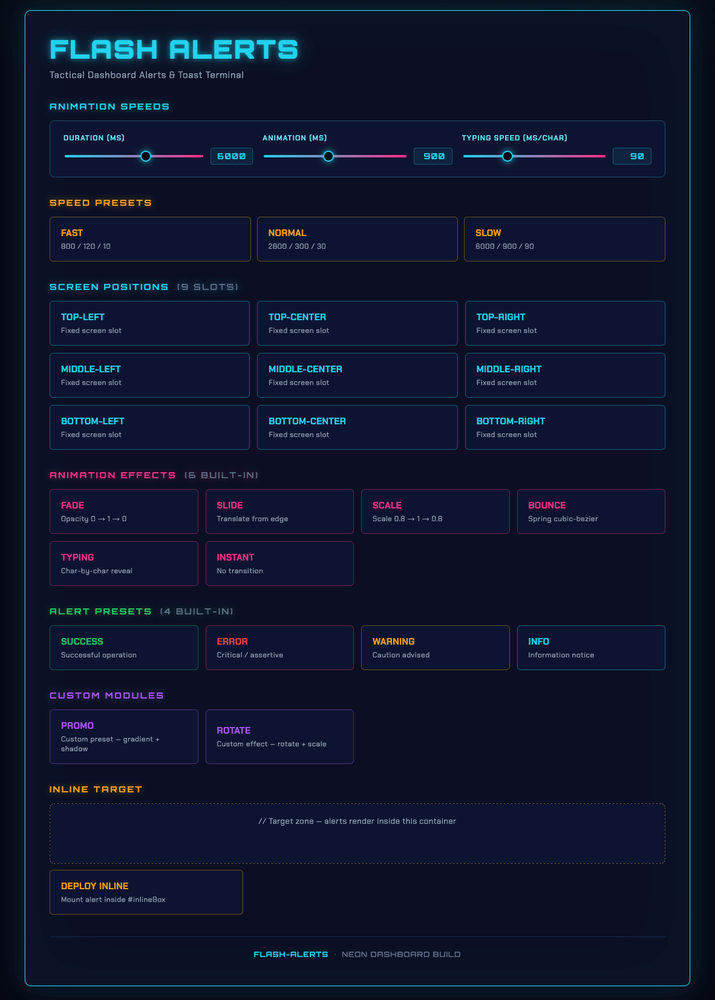

# flash-alerts

[](https://www.npmjs.com/package/flash-alerts)
[](https://www.npmjs.com/package/flash-alerts)
[](./LICENSE)
[](https://insider515.github.io/flash-alerts/examples/demo.html)

Zero-dependency browser alerts / toasts.
Configurable position, effects, styles, and presets. UMD + CJS + ESM. TypeScript definitions. Accessible (`role`, `aria-live`, `prefers-reduced-motion`).

- **Size:** ~9 KB minified, ~2.8 KB gzipped.
- **Dependencies:** none in production.
- **Browser support:** any browser with `Promise`, `requestAnimationFrame`, `matchMedia`.

**Links**
- **Live demo:** <https://insider515.github.io/flash-alerts/examples/demo.html>
- **npm:** <https://www.npmjs.com/package/flash-alerts>
- **GitHub:** <https://github.com/Insider515/flash-alerts>



---

## Install

```bash
npm install flash-alerts
```

Or load from CDN:

```html
<script src="https://unpkg.com/flash-alerts/dist/flash-alerts.min.js"></script>
```

---

## Quick start

```js
import FlashAlerts from 'flash-alerts';
// or (CDN / UMD): const FlashAlerts = window.FlashAlerts;

const alerts = new FlashAlerts({
    position: 'top-right',
    effect: 'fade',
    duration: 4000,
    animation: 300
});

alerts.show('Saved');
alerts.success('Payment accepted');
alerts.error('Server returned 500');
alerts.warning('Low balance');
alerts.info('New message');
```

---

## API

### `new FlashAlerts(options?)`

| Option | Type | Default | Description |
| --- | --- | --- | --- |
| `position` | `Position` | `'top-right'` | Default screen position for alerts. |
| `effect` | `string` | `'fade'` | Default animation effect. |
| `duration` | `number` | `4000` | How long an alert is visible, ms. |
| `animation` | `number` | `300` | Enter/exit animation length, ms. |
| `typingSpeed` | `number` | `30` | ms per char, for `typing` effect. |
| `gap` | `number` | `10` | Space between stacked alerts, px. |
| `margin` | `number` | `20` | Container inset from screen edge, px. |
| `zIndex` | `number` | `9999` | Fixed-container z-index. |
| `style` | `StyleMap` | sensible defaults | Inline CSS overrides for alert box. |
| `role` | `string` | `'status'` | ARIA role on the alert element. |
| `ariaLive` | `AriaLive` | `'polite'` | `aria-live` region value. |
| `respectReducedMotion` | `boolean` | `true` | If true, honours `prefers-reduced-motion`. |

### `alerts.show(text, opts?)`

Shows an alert. Returns a handle `{ close, element }`.

```js
const h = alerts.show('Uploading…', {
    position: 'bottom-center',
    effect: 'slide',
    duration: 10000,
    style: { background: '#111', color: '#fff' },
    onShow: (el) => console.log('shown', el),
    onHide: (el) => console.log('hidden', el)
});

// Programmatic dismiss:
h.close();
```

Options accepted by `show()`:

| Option | Type | Description |
| --- | --- | --- |
| `position` | `Position` | Overrides instance default. |
| `effect` | `string` | Overrides instance default. |
| `duration`, `animation`, `typingSpeed` | `number` | Per-call overrides. |
| `style` | `StyleMap` | Merged over defaults and preset. |
| `target` | `string \| HTMLElement \| null` | Mount inside a specific DOM element instead of using a fixed screen position. Accepts a CSS selector or an element. If null/missing, falls back to `position`. |
| `preset` | `string` | Apply a preset by name before `style`. |
| `html` | `boolean` | If true, uses `innerHTML` (dangerous — sanitize upstream). Default `textContent`. |
| `role` | `string` | ARIA role on the element. |
| `ariaLive` | `'off' \| 'polite' \| 'assertive'` | `aria-live` region. |
| `respectReducedMotion` | `boolean` | Overrides instance default. |
| `onShow(el)`, `onHide(el)` | `function` | Lifecycle callbacks. |

### Shortcut methods

Each registered preset becomes a method:

```js
alerts.success('Saved');
alerts.error('Error', { position: 'bottom-right' });
alerts.warning('Careful');
alerts.info('FYI');
```

Shortcuts do not override instance methods — `alerts.show` always stays the real `show()`.

### `alerts.addPreset(name, config)`

Register a reusable preset:

```js
alerts.addPreset('promo', {
    style: {
        background: 'linear-gradient(135deg, #ff8a00, #e52e71)',
        color: '#fff',
        'font-weight': '600'
    },
    duration: 6000
});

alerts.promo('Black Friday — 40% off');
alerts.show('Same thing', { preset: 'promo' });
```

### `alerts.addEffect(name, effect)`

Register a custom effect. An effect is an object with up to three functions. Returning a `Promise` from `in` delays the dismiss timer:

```js
alerts.addEffect('rotate', {
    prepare(el, ctx) {
        el.style.opacity = '0';
        el.style.transform = 'rotate(-20deg) scale(.6)';
        el.style.transition =
            'transform ' + ctx.animation + 'ms ease, opacity ' + ctx.animation + 'ms ease';
    },
    in(el) {
        return new Promise(resolve => {
            requestAnimationFrame(() => requestAnimationFrame(() => {
                el.style.opacity = '1';
                el.style.transform = 'rotate(0deg) scale(1)';
                resolve();
            }));
        });
    },
    out(el) {
        el.style.opacity = '0';
        el.style.transform = 'rotate(20deg) scale(.6)';
    }
});

alerts.show('Hi', { effect: 'rotate' });
```

### `alerts.configure(options)`

Update instance defaults in place. `style` is merged, not replaced. Returns `this`.

```js
alerts.configure({ duration: 6000, style: { background: '#000' } });
```

### Static fields

```js
FlashAlerts.POSITIONS; // string[9]
FlashAlerts.EFFECTS;   // ['fade', 'slide', 'scale', 'bounce', 'typing', 'instant']
FlashAlerts.PRESETS;   // ['success', 'error', 'warning', 'info']
```

---

## Positions

Nine fixed screen positions, plus mounting inside any DOM element.

```
top-left     top-center     top-right
middle-left  middle-center  middle-right
bottom-left  bottom-center  bottom-right
```

Mount inside an element:

```js
alerts.show('Inline alert', { target: '#notice-box', effect: 'slide' });
alerts.show('Inline alert', { target: document.getElementById('notice-box') });
```

If `target` is given, `position` is ignored. If the selector matches nothing, `show()` falls back to `position`.

---

## Built-in effects

| Name | Behaviour |
| --- | --- |
| `fade` | Opacity 0 → 1 → 0. |
| `slide` | Slide in from the nearest screen edge of the chosen position. |
| `scale` | Scale 0.8 → 1 → 0.8 with fade. |
| `bounce` | Spring-easing scale (`cubic-bezier`). |
| `typing` | Instant box, text typed character-by-character. |
| `instant` | No transitions. |

---

## Built-in presets

| Preset | Background | Text | ARIA |
| --- | --- | --- | --- |
| `success` | green | white | default (`polite`, `status`) |
| `error` | red | white | **`assertive`, `role="alert"`** |
| `warning` | yellow | near-black | default |
| `info` | cyan | white | default |

`error` interrupts the screen reader; other presets wait their turn.

---

## Accessibility

Each alert carries:

- `role` — `status` by default, `alert` for the `error` preset.
- `aria-live` — `polite` by default, `assertive` for `error`.
- `aria-atomic="true"` — screen reader reads the whole text.

`respectReducedMotion: true` (default) forces `effect: 'instant'`, `animation: 0`, `typingSpeed: 1` whenever `window.matchMedia('(prefers-reduced-motion: reduce)').matches` is true.

Override per call:

```js
alerts.show('High-priority event', { ariaLive: 'assertive', role: 'alert' });
```

---

## Styling

All visuals are inline styles, no external CSS required. Nine styling knobs are supported out of the box:

```js
new FlashAlerts({
    style: {
        background:    'rgba(0,0,0,.82)',
        color:         '#ffffff',
        padding:       '12px 18px',
        'border-radius': '6px',
        border:        'none',
        'font-family': 'inherit',
        'font-size':   '14px',
        'font-weight': '400',
        'box-shadow':  '0 6px 20px rgba(0,0,0,.18)'
    }
});
```

Priority: `defaults.style < preset.style < show().style`.

Keys can be `kebab-case` or `camelCase`. Any CSS property is accepted — the list above is just the designed-for set.

---

## TypeScript

Type definitions ship with the package. In TS:

```ts
import FlashAlerts from 'flash-alerts';
import type { Position, ShowOptions, Preset } from 'flash-alerts';

const alerts = new FlashAlerts({ position: 'top-right' });

const opts: ShowOptions = { effect: 'bounce', duration: 3000 };
alerts.show('Hi', opts);
```

---

## Entry points

| File | Purpose |
| --- | --- |
| `src/flash-alerts.js` | UMD source (readable; works via `<script>`, CJS, AMD). |
| `dist/flash-alerts.min.js` | Minified UMD for production and CDNs. |
| `index.js` | CJS entry — reexports `src/flash-alerts.js`. |
| `index.mjs` | ESM entry (Node, bundlers). |
| `index.d.ts` | TypeScript types. |

---

## Build and test

```bash
npm test     # 71+ unit tests via node:test + jsdom
npm run build # minifies src/ into dist/ via terser
```

---

## License

MIT — see [LICENSE](./LICENSE).
